This repository contains a Skia-backed implementation of `Vcl.Graphics.TCustomCanvas` for Windows/Delphi and FPC on Windows or Linux. It provides VCL-style drawing, shaped text, raster surfaces that can be exported to PDF and SVG.

All repository-relative paths and commands below are relative to the project
root, `D:\projects\externals\Skia4DelphiCanvas` on Windows or
`/mnt/d/projects/externals/Skia4DelphiCanvas` in WSL. For another clone,
substitute its root directory. Native sources are in the [Skia submodule](skia);
installed libraries and static linker inputs are in [runtime](runtime/README.md).

Native Windows builds support Delphi and FPC 3.3.1 or later. Both use the
vendored Skia4Delphi 7.3.0 `System.Skia` bindings and a matching m151 `sk4d.dll`.

## Features

- **Shapes:** lines, polylines, polygons, cubic Beziers, rectangles, rounded rectangles, ellipses, arcs, chords and pies.
- **Brushes:** solid and transparent fills, all six VCL hatch styles, horizontal/vertical gradients, repeating bitmap patterns and opacity.
- **Pens:** VCL styles, custom dash intervals, stroke caps, joins, miter limits, opacity and all 16 `Pen.Mode` ROP2 operations. `psInsideFrame` insets strokes for rectangles, ellipses, rounded rectangles, chords and pies.
- **Images:** `Draw`, opacity drawing, `StretchDraw`, `CopyRect`, `BitBlt`, `StretchBlt`, `MaskBlt` and affine `PlgBlt`. Signed `StretchBlt` spans support reflection. `CopyMode` supports all 256 ROP3 truth tables.
- **VCL graphics:** bitmap alpha and color keys, plus `TGraphic` conversion for PNG and icons. `TMetafile` playback uses the EMF parser and retains vector geometry and recorded glyph outlines.
- **Text:** outline rendering, kerning, ligatures, contextual shaping, bidirectional layout, combining marks, underline, strikeout, opacity and VCL font orientation. `TextRect` supports wrapping, alignment, ellipsis, tabs, accelerator prefixes, `tfCalcRect` and `tfModifyString`. Methods for draw text along a curve or polyline.
- **Fonts:** custom typeface aliases, loading from files or streams, collection face selection, cached metrics, outlines and shaping resources.
- **Coordinates and clipping:** world matrices, translation, scaling, rotation, `LPToDP`/`DPToLP`, rectangular and path/region clips, intersections and exclusions.
- **State and pixels:** nested or indexed `SaveState`/`RestoreState`, `Pixels`, brush-based `FloodFill`, bitmap export and image snapshots.
- **Recording:** finish a picture, replay it to another canvas or serialize it as SKP. The demos replay the same scene to raster, PDF and SVG targets.

## Library classes

| Type | Purpose |
| --- | --- |
| `TSkiaCanvas` | Wraps an existing `ISkCanvas` or `ISkSurface`; implements drawing, transforms, clipping and state management. |
| `TSkiaBitmapCanvas` | Owns a raster surface; exposes `Flush(TBitmap)`, `Snapshot`, `Width` and `Height`. |
| `TSkiaMetafileCanvas` | Records drawing; exposes `FinishRecording` and `Playback`. |
| `TSkiaBrush` | Adds `Alpha`, `Gradient`, gradient colors and an owned `Pattern` bitmap to `TBrush`. |
| `TSkiaPen` | Adds `Alpha`, `StrokeCap`, `StrokeJoin`, `MiterLimit` and `DashPattern` to `TPen`. |
| `TSkiaFont` | Adds text `Alpha` to `TFont`. |
| `TSkiaFontManager` | Resolves typefaces and manages custom font aliases. |
| `TSkiaResourceManager` | Caches fill paints, stroke paints and fonts. |
| `TSkiaGdiGlyphCache` | Caches GDI metrics, outlines, kerning and Uniscribe resources. |
| `TSkiaCanvasState` | Stores the resource and coordinate snapshots used by the state stack. |

Please keep the `SkiaCanvas.*.inc` implementation files, [Vcl.GraphUtil.MetafileParser.pas](src/Vcl.GraphUtil.MetafileParser.pas) and its `MetafileParser.Replay.inc` and `MetafileParser.Fpc.inc` implementations alongside the unit.

## Requirements:

### Native Windows / Win32 and Win64
- Windows and RAD Studio with the Win32 and Win64 Delphi compilers.

- FPC 3.3.1 or later upstream Skia wrapper uses anonymous functions and Unicode string support unavailable in FPC 3.2.x).
- Lazarus LCL sources and the Windows widget set. The resource adapter uses real LCL bitmaps, fonts, pens and brushes, plus Windows GDI for text outlines and EMF playback.
- A `sk4d.dll` matching the target architecture and pinned Skia4Delphi 7.3.0 bindings in `src/fpc/vendor`.
- Vendored `System.Skia` units from `src/fpc/vendor`, selected by the runners.
- Skia4Delphi 7.3 / m151 `sk4d.dll` files in `runtime/win32` and `runtime/win64`.
- For image tests: Python with Pillow; set `SKIA_PYTHON` to select the interpreter.

The scripts have been exercised with RAD Studio 23.0. From the repository root, run in PowerShell:

```powershell
Set-Location D:\projects\externals\Skia4DelphiCanvas
.\tests\run_tests.cmd
.\demo\run_demos.cmd
```

Each script builds and runs its targets for **both Win32 and Win64**. The default compiler environment is `D:\Embarcadero RAD Studio\23.0\bin\rsvars.bat`. To use another installation, pass its environment script:

```powershell
.\tests\run_tests.cmd "C:\Path To RAD Studio\bin\rsvars.bat"
.\demo\run_demos.cmd "C:\Path To RAD Studio\bin\rsvars.bat"
```
### Linux / x86-64 (GTK2)

Linux builds use FPC 3.3.1 or later, Lazarus LCL with GTK2, and the matching
Skia4Delphi 7.3.0 / Skia m151 `libsk4d.so`. Native font selection, OpenType glyph-cache
shaping and bidi runs use Fontconfig, HarfBuzz and FriBidi. On Ubuntu, install
the build and verification dependencies:

```bash
sudo apt-get install libgtk2.0-dev libfontconfig1-dev libharfbuzz-dev libfribidi-dev \
  xvfb poppler-utils librsvg2-bin python3-pil python3-pypdf
```

Run from Linux or WSL. This example uses the verified local WSL toolchain;
set the compiler, matching units and Lazarus paths for your installation:

```bash
cd /mnt/d/projects/externals/Skia4DelphiCanvas
export FPC=/home/at/skia-canvas-toolchain/fpcsrc/compiler/ppcx64
export FPC_UNITS_ROOT=/home/at/skia-canvas-toolchain/units/x86_64-linux
export LAZARUS_ROOT=/mnt/d/fpc/lazarus
export SKIA_LIBRARY_DIR="$PWD/runtime/linux64"
unset SKIA_EMF_FILTER SKIA_TEST_GROUP
bash tests/run_tests_linux.sh
bash demo/run_demos_linux.sh --verify
```

## Skia Version

Use **Skia4Delphi 7.3.0 Pascal API at `fce5db2` with native Skia 151.0.1** for every
configuration below. The DLLs and static objects are built from the same
`sk4d/m151` checkout, revision `e5e4933ea025f5e1b8a07d038e38869e205deb06`.
Use the project-built DLLs, static objects and Linux shared library: the build
scripts apply an SVG nearest-neighbor sampling fix to generated compatibility
sources outside the pinned submodule. Unmodified upstream binaries do not
include this fix. Do not combine these bindings with the old 6.x runtime package.

The Pascal units are pinned to upstream
[`fce5db2ffcf547f597f5f0a6b2125d779d5598e3`](https://github.com/skia4delphi/skia4delphi/commit/fce5db2ffcf547f597f5f0a6b2125d779d5598e3).
This adds `TSkFontFeature` and read-only `TSkTextStyle.FontFeatures` / `Shadows`
through `TSkTextStyleHelper`. The intervening upstream updates also add
font edging/hinting/subpixel properties and an empty `TSkPixmap.Create`,
and correct region and clipped-region enumeration. These APIs are available
in Delphi and FPC, with DLL/static linking on Windows and shared linking on Linux.
The shared regression tests check array values, ownership, resets, empty arrays,
constructor lifetime and first/last region rectangles. FPC shadow transfers use
explicit C record padding and field conversion to preserve the native ABI.

`TSkiaCanvas` exposes `FontEdging`, `FontHinting` and `FontSubpixel`:

```pascal
Canvas.FontEdging := TSkFontEdging.AntiAlias;
Canvas.FontHinting := TSkFontHinting.Normal;
Canvas.FontSubpixel := True;
```

The defaults retain the previous platform behavior. `SaveState`/`RestoreState`
include all three settings. Acquired fonts retain their settings when later canvas
changes occur. With explicit settings and `TextToCurves=False`, raster targets
use native Skia glyph rendering. Outline text and PDF/SVG recordings retain
vector contours; edging controls contour antialiasing, while hinting applies
to native raster glyphs. `FontSubpixel` enables fractional glyph positioning;
`SubpixelAntiAlias` requests LCD antialiasing. Skia may use grayscale antialiasing
when the target does not support LCD rendering.

`ISkPixmap` and `TSkPixmap` are also exported by `Vcl.Graphics.Skia`, including
the empty constructor used as a destination for `ExtractSubset`:

```pascal
Source := TSkPixmap.Create(ImageInfo, PixelBuffer, RowBytes);
Subset := TSkPixmap.Create;
Source.ExtractSubset(Subset, Rect(0, 0, 16, 16));
Canvas.DrawPixmap(20, 30, Subset);
Canvas.DrawPixmap(Rect(20, 30, 84, 94), Subset); // scale to the destination
BitmapCanvas.ReadPixels(DestinationPixmap, 20, 30);
```

Pixmap constructors borrow the pixel buffer; the caller keeps its storage alive.
`DrawPixmap` copies the pixels before drawing, so recordings remain valid after
source changes or release. It honors canvas transforms, clipping and copy mode.
Nil/empty sources are no-ops. `TSkiaBitmapCanvas.ReadPixels` writes to caller-owned
pixmap storage in device coordinates, independently of the current transform and
clip, and returns `False` for nil/empty destinations or nonoverlapping reads.
The destination pixmap must already describe valid allocated storage.
Atlas pages `07-text-fonts` and `08-raster-resources` demonstrate these APIs.

| Target | DLL deployment | Static objects |
| --- | --- | --- |
| Delphi Win32 | `runtime/win32/sk4d.dll` | `runtime/windows-static/Binary/Static/Win32` |
| Delphi Win64 | `runtime/win64/sk4d.dll` | `runtime/windows-static/Binary/Static/Win64` |
| FPC Win32 | `runtime/win32/sk4d.dll` | `runtime/windows-static/Binary/Static/FPC/Win32` |
| FPC Win64 | `runtime/win64/sk4d.dll` | `runtime/windows-static/Binary/Static/FPC/Win64` |

For DLL linking, put `src/fpc/vendor` and `src` in the unit search path and
deploy the DLL matching the EXE architecture beside the executable. Leave
`SK_STATIC_LIBRARY` undefined. The DLL includes the C++ runtime; a separate
`libc++.dll` or `libunwind.dll` is not needed. The ordinary Delphi/FPC runners
already select these units and copy the correct DLL.

For static linking, define `SK_STATIC_LIBRARY` and put
`runtime/windows-static/Source` **before** `src/fpc/vendor` and `src` in the unit
search path. Keep that package's `Source` and `Binary` directories together:
the generated `System.Skia.API.pas` links its matching COFF objects. No
`sk4d.dll` is deployed. Windows system DLLs and the Universal C Runtime remain
required. Static objects are compiler-specific; a DLL import library is not
a replacement for this package. Both FPC targets use FPC 3.3.1 and their
matching RTL/packages. The validated Win32 compiler is a native i386 build
from FPC revision `fa51767875e16b9ab7ae8f37c8817bcb90452fae`.

Run the prepared static package:

```powershell
./scripts/build_delphi_static.ps1 -Target tests -Platforms win32,win64
./scripts/build_delphi_static.ps1 -Target demo -Platforms win32,win64
$static = "$PWD/runtime/windows-static"
./scripts/build_fpc_native.ps1 -Target tests -StaticSkiaRoot $static
./scripts/build_fpc_native.ps1 -Target demo -StaticSkiaRoot $static
./scripts/build_fpc_native.ps1 -Target tests -Platform win32 -StaticSkiaRoot $static
./scripts/build_fpc_native.ps1 -Target demo -Platform win32 -StaticSkiaRoot $static
python scripts/verify_static_skia.py demo/build/win32-static/SkiaDemo.exe demo/build/win64-static/SkiaDemo.exe demo/build/fpc-static-win32/SkiaDemo.exe demo/build/fpc-static-win64/SkiaDemo.exe
```

Outputs are under `tests/build/win32-static`, `tests/build/win64-static`,
`tests/build/fpc-static-win32`, `tests/build/fpc-static-win64` and the corresponding `demo/build` directories.
The static runners execute with a Windows-only `PATH`. The PE verifier rejects
normal or delayed Skia DLL imports, an embedded DLL name, or a DLL beside an EXE.

### Rebuilding the Windows runtimes

Skia is the `skia` Git submodule, pinned to upstream default branch
`sk4d/m151` at `e5e4933ea025f5e1b8a07d038e38869e205deb06` (2026-10-16).
Upstream has no `master` branch. Normal submodule initialization checks out
this exact revision; use `git submodule update --init --recursive`, without
`--remote`, to reproduce it. Synchronize the pinned third-party dependencies
with `-SyncDependencies` on the first Windows build, or `SKIA_SYNC_DEPS=1`
for the first Linux build. GN is fetched automatically if absent.
The tested toolchain is LLVM-MinGW 18.1.8 UCRT, with Ninja and Python 3.12.
The static packager additionally uses GNU Binutils `ld` 2.42 from `PATH` (override with `--ld` when running the
packager directly).

```powershell
git submodule update --init --recursive
# LLVM-MinGW 18.1.8 UCRT, extracted into this directory (or another location):
$env:LLVM_MINGW_ROOT = "$PWD/runtime/toolchains/llvm-mingw-20240619-ucrt-x86_64"
./scripts/build_native_skia.ps1 -Platform win32 -Linkage dll -SyncDependencies
./scripts/build_native_skia.ps1 -Platform win64 -Linkage dll
./scripts/build_native_skia.ps1 -Platform win32 -Linkage static
./scripts/build_native_skia.ps1 -Platform win64 -Linkage static
```

DLL builds install in `runtime/win32` or `runtime/win64` and record their version,
source revision, GN arguments and SHA-256 in `build-info.json`. All native intermediates are under `runtime/build`, including archives
`runtime/build/static-win32/sk4d.a` and `runtime/build/static-win64/sk4d.a`.
Static builds automatically run the packager and write the ready-to-use
Pascal package to `runtime/windows-static`; `--output` changes that destination.
Linux builds use the same submodule and output layout:

```bash
SKIA_SYNC_DEPS=1 bash scripts/build_native_skia_linux.sh
```

The Linux intermediate directory is `runtime/build/linux64`; the installed
library is `runtime/linux64/libsk4d.so`. `SKIA_SOURCE_DIR`, `SKIA_BUILD_DIR`
and `SKIA_RUNTIME_DIR` remain available for explicit overrides. The Windows builder stages a DirectWrite source with an explicit constexpr
enum cast under `runtime/build/*/compat` for LLVM-MinGW 18 and redirects its
generated Ninja compile rule. The pinned upstream sources remain unchanged.

Per-platform manifests record native archive and COFF hashes and verify all
815 imported C API functions.
## Start with the demos

[SkiaUsageExamples.pas](demo/SkiaUsageExamples.pas) contains short procedures that can be reused in an application. They accept an existing canvas and restore its state with `try..finally`.

| Procedure | Demonstrates |
| --- | --- |
| `DrawQuickStart` | A complete scene with gradient fill, pen outline, shaped text, clipping, transforms and state restoration. |
| `DrawMaskedTransfer` | Masked copying with local scaling followed by positioning. |
| `DrawKeyedBitmap` | Replacing key-colored pixels with a brush color. |
| `DrawXorCopy` | Destination-dependent copying with `SRCINVERT`. |
| `DrawClippedFill` | Replacing, intersecting and excluding clip rectangles. |

[SkiaDemo.pas](demo/SkiaDemo.pas) shows raster canvas creation, drawing, `Flush` and bitmap saving. [SkiaPdfSvgDemo.pas](demo/SkiaPdfSvgDemo.pas) shows picture recording, PDF pages, SVG output and SKP serialization, including stream and interface lifetimes.

A minimal Delphi application using the shared scene:

```pascal
program RasterExample;

{$APPTYPE CONSOLE}

uses
  Vcl.Graphics,
  Vcl.Graphics.Skia,
  SkiaUsageExamples;

var
  Canvas: TSkiaBitmapCanvas;
  Bitmap: TBitmap;
begin
  Canvas := TSkiaBitmapCanvas.Create(QuickStartWidth, QuickStartHeight);
  Bitmap := TBitmap.Create;
  try
    DrawQuickStart(Canvas);
    Canvas.Flush(Bitmap);
    Bitmap.SaveToFile('example.bmp');
  finally
    Bitmap.Free;
    Canvas.Free;
  end;
end.
```

To record the same scene, create `TSkiaMetafileCanvas`, call `DrawQuickStart`, then obtain `ISkPicture` with `FinishRecording`. The picture remains valid after the recorder is freed. Use `Picture.Playback` with a PDF page or SVG canvas as shown in `ExportQuickStart` in the vector demo.

### Demo output

Native demos save generated files beside their executables in
`demo/build/<configuration>/`. The previews below are the checked-in SVG examples
in `demo/`, independent of generated build output:

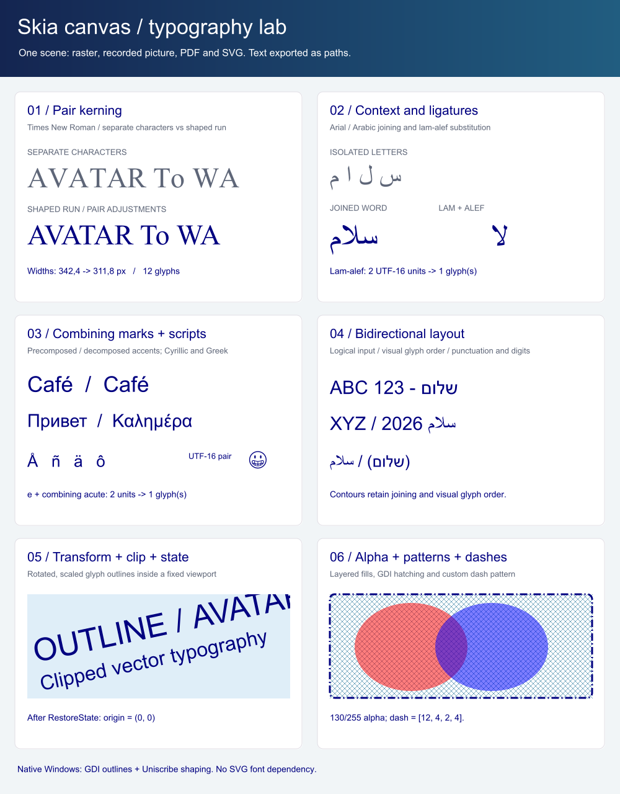
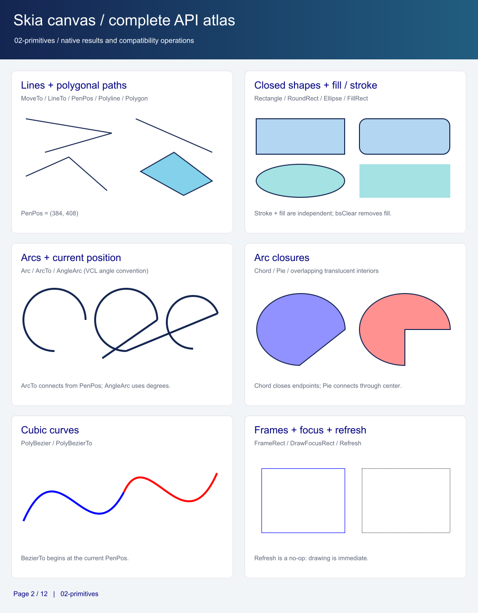
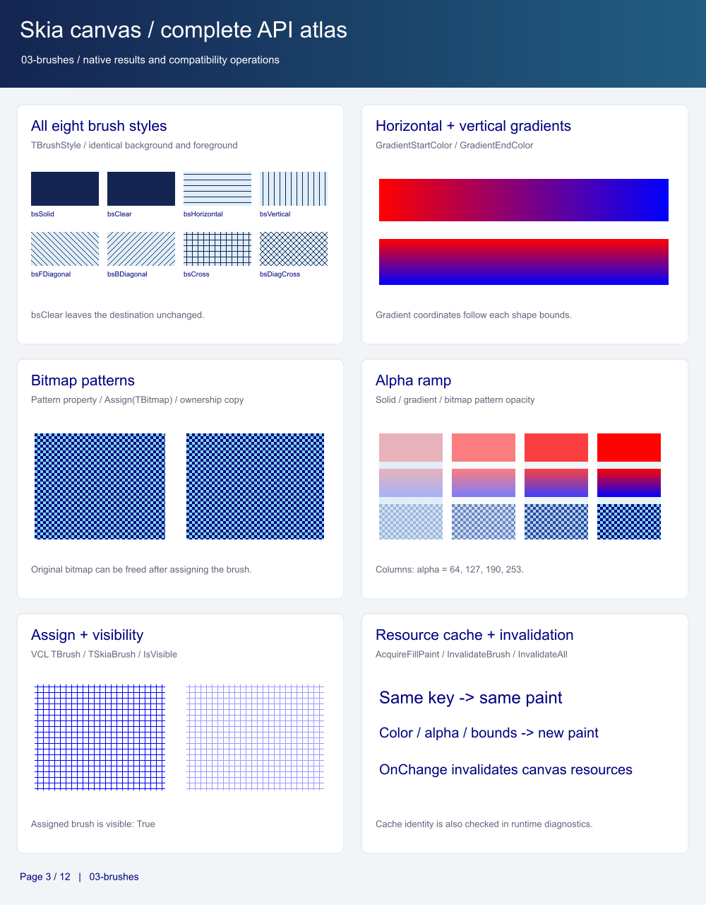
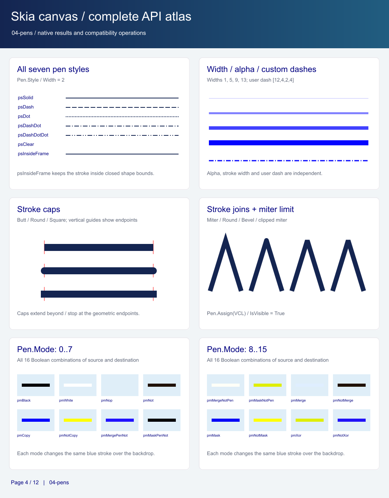
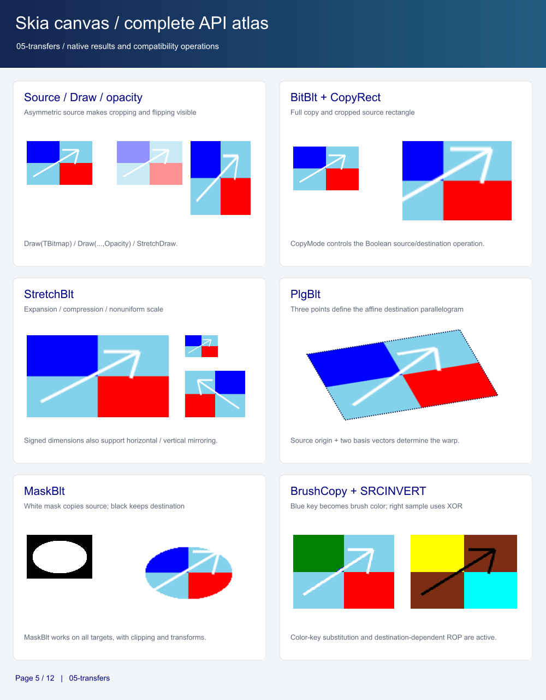
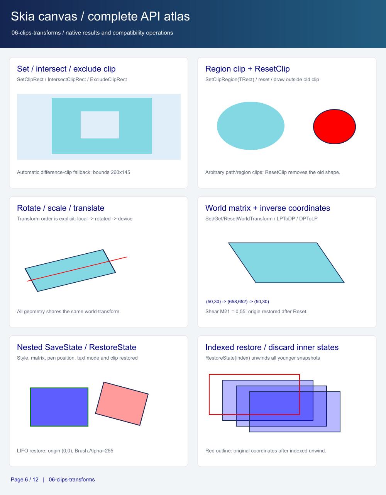
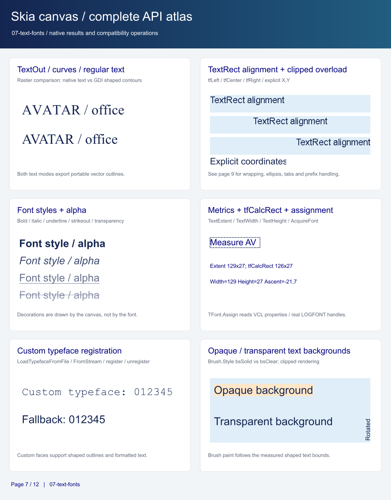
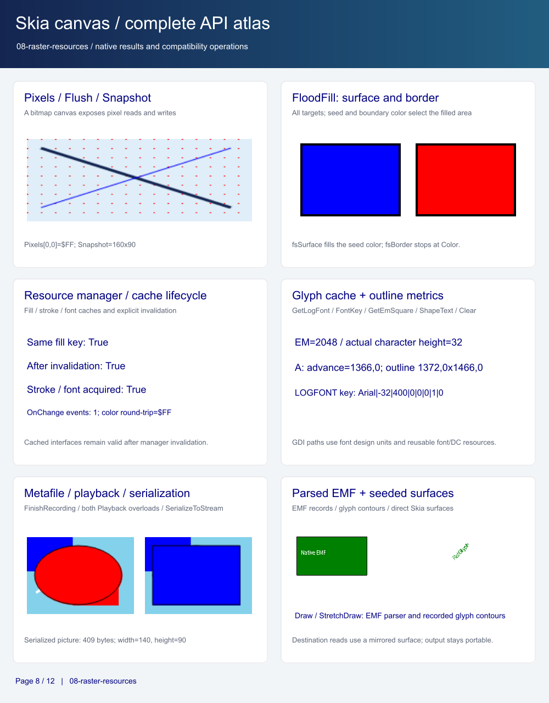
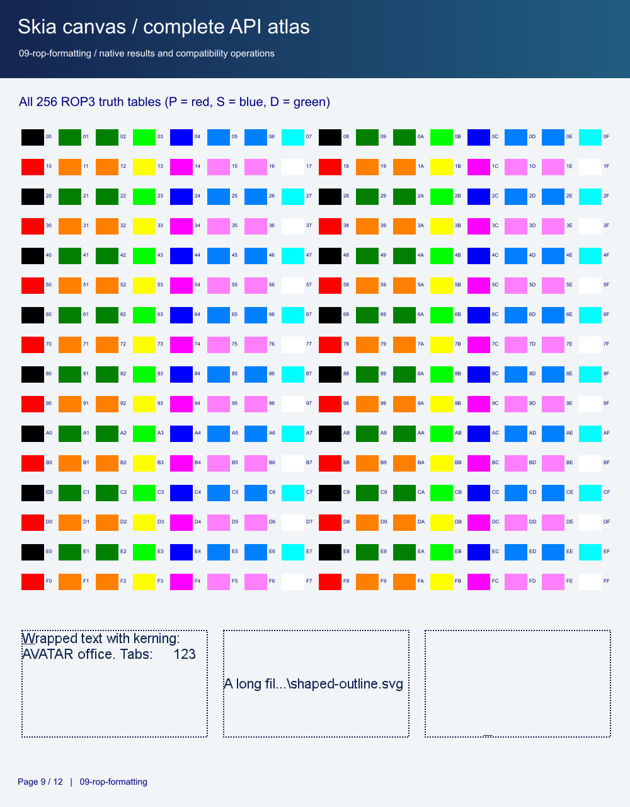
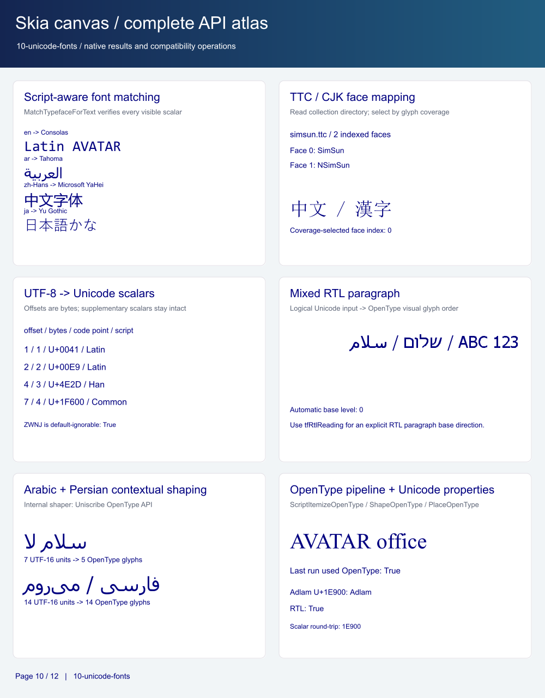
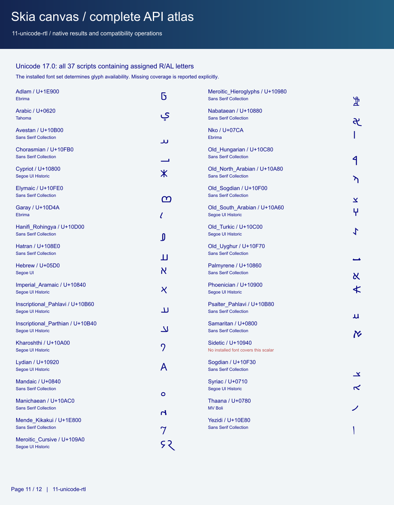
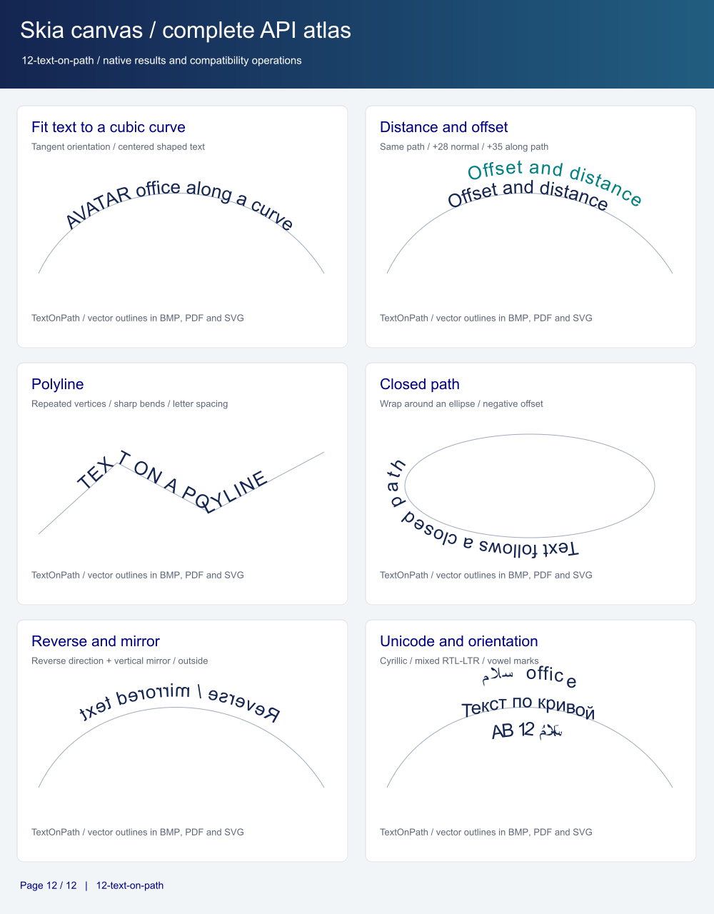

| Files | Contents |
| --- | --- |
| `quickstart.bmp`, `quickstart.pdf`, `quickstart.svg` | The small reusable scene, 600 x 360. |
| `skia_demo.pdf` | The twelve-page API atlas, with 1000 x 1280 pages. |
| `skia_demo.bmp`, `skia_demo.svg`, `skia_demo.skp` | The typography page of the atlas. |
| `02-primitives.*` through `12-text-on-path.*` | The remaining atlas pages, each saved as BMP, SVG and SKP. |

[SkiaDemoScenes.pas](demo/SkiaDemoScenes.pas) contains typography examples. [SkiaAtlasScenes.pas](demo/SkiaAtlasScenes.pas) covers primitives, brushes, pens, image transfers, clipping/transforms, fonts, resources and all 256 ROP3 tables. [SkiaUnicodeScenes.inc](demo/SkiaUnicodeScenes.inc) adds script-aware font matching, indexed TTC/CJK mapping, strict UTF-8 scalar decoding, mixed RTL paragraphs and Arabic/Persian OpenType shaping. Page 11 lists all 37 scripts with assigned RTL letters in Unicode 17.0, including supplementary-plane scripts; it reports missing installed font coverage explicitly. Its named `Draw...` procedures can also draw individual pages on a sufficiently sized canvas.

[api-coverage.json](demo/api-coverage.json) maps public API member names to atlas pages. Check its completeness with:

```bash
python demo/check_api_coverage.py
```

## Text along a curve or polyline

`TSkiaCanvas.TextOnPath` accepts an `ISkPath`, an array of `TPointF`, or an array
of `TPoint`. It shapes the complete single-line text with native Skia paragraph
layout, preserving kerning, ligatures, bidi ordering and private typefaces, then
places rigid glyph outlines along the path. It always emits vector outlines,
independently of `TextToCurves`; the selected font must provide glyph outlines.
Family, size, bold/italic, color and alpha come from `Font`. The background brush,
underline/strikeout and `Font.Orientation` are not applied. Canvas transforms and
clipping apply normally; drawing does not change canvas state.

```pascal
Canvas.Font.Name := 'Arial';
Canvas.Font.Height := -28;
Canvas.TextOnPath('Text on a polyline',
  [Point(30, 150), Point(180, 60), Point(360, 130)], 20, 12);

Options := TSkiaTextPathOptions.Default;
Options.Alignment := tpaCenter;
Options.Offset := 15;
Options.Distance := 20;
Canvas.TextOnPath('Centered text on a curve', Path, Options);
```

Declare `Options: TSkiaTextPathOptions` and `Path: ISkPath` in the second example.
The caller owns the path; it is never modified.

| Option | Behavior |
| --- | --- |
| `Offset` | Additional distance along the path, in logical canvas units. |
| `Distance` | Baseline distance to the left of the directed path; positive values are above a rightward horizontal line. |
| `Alignment` | `tpaStart` (default), `tpaCenter`, or `tpaEnd`; offset is added after alignment. |
| `LetterSpacing` | Extra spacing in logical units, applied by the shaping engine. |
| `Orientation` | `tpoTangent` rotates each glyph with the tangent; `tpoHorizontal` keeps glyphs horizontal. |
| `Reverse` | Starts at the other end and reverses path direction and its normal. |
| `MirrorHorizontal`, `MirrorVertical` | Reflect the shaped run horizontally (including glyph order) or vertically about its baseline. |
| `Wrap` | Wraps distances around a closed contour; defaults to `False`. |

Only the first contour is used. The point overloads make an open polyline;
use a closed `ISkPath` for wrapping. Empty text, nil paths and zero-length paths
draw nothing. Glyphs whose advance centers fall outside an unwrapped path are
omitted; individual glyph outlines may extend past its endpoints. Multiline text
and nonfinite coordinates/offsets raise `ESkiaCanvasError`.

Atlas page 12 (`12-text-on-path.bmp`, `.svg`, `.skp`, and page 12 of
`skia_demo.pdf`) demonstrates cubic and polygonal paths, normal/along-path offsets,
closed-path wrapping, reverse/mirrored text and Cyrillic/Arabic shaping.
Shared tests exercise offsets, alignment, path direction, mirrors, wrapping,
orientation, clipping/transforms, private fonts, invalid input and vector PDF/SVG
recording under Delphi Win32/Win64 and FPC Windows/Linux.

The 21 dedicated checks are included in the shared Delphi/FPC suite for
DLL/static Win32/Win64 and Linux FPC 3.3.1. FPC reports zero unfreed Pascal
blocks.
The demo export audit checks all 12 atlas pages and quickstart; page 12 must have
no SVG image elements or PDF image objects.
WSL/Poppler/librsvg verification passes for all nine TextOnPath demo pages
(eight Windows DLL/static configurations and native Linux). Each page contains
SVG glyph paths with no SVG text/image elements or PDF image objects, and its
PDF/SVG renderings agree with the native BMP scene.

## Unicode and OpenType helpers

`TSkiaUnicode.DecodeUtf8` returns scalar values with one-based byte offsets and byte lengths; malformed, overlong and surrogate encodings raise `ESkiaCanvasError`. `CodePoints` and `ScalarText` convert between scalars and UTF-16 without splitting supplementary characters. `ScriptName`, `BidiClass`, `IsRightToLeft` and `IsDefaultIgnorable` use the pinned [Unicode 17.0 database](https://www.unicode.org/Public/17.0.0/ucd/); they classify text independently of the operating system's font set and shaping support. `ParagraphLevel` determines the first strong direction outside isolate controls.

`FontManager.MatchTypefaceForText(Text, PreferredFamily, Language)` checks actual glyph coverage, tries script/language preferences and then installed families. It returns `nil` when no single font covers the run. It does not split a mixed-script string into independent font runs. `CollectionFaceCount` validates SFNT/TTC directories and table bounds. `MatchCollectionTypeface` selects a covering face and returns its zero-based index, or `nil` / `-1` when no face matches.

`GlyphCache.ShapeText` shapes all supported scripts through the Uniscribe OpenType APIs and returns visual-order glyph IDs, advances and offsets. Pass `RequireOpenType=True` to reject shaping failures instead of using compatibility glyph mapping with pair kerning. This strict mode is used by the Arabic/Persian demos and tests. Check its Boolean result and `LastShapeUsedOpenType`; use the same LOGFONT, font key and EM square as the normal canvas text pipeline. Unicode property coverage is separate from glyph availability and the scripts supported by the installed Windows shaping engine.

The Unicode tables can be regenerated with `python scripts/generate_unicode_data.py`. The generated data uses the [Unicode license](src/UNICODE-LICENSE.txt). `tests/fixtures/generate_font.py` generates the original TTF and two-face TTC fixtures; the TTC places its CJK test glyphs in face 1 so tests detect accidental face-zero loading.

## Usage details

- **Resource ownership:** canvases own their pen, brush, font and managers. Assigning these properties copies attributes. Assigning `Brush.Pattern` copies the bitmap. Caller-supplied graphics and streams remain caller-owned; Skia interfaces use reference counting.
- **Transforms:** drawing uses logical coordinates. Transform order matters; the examples rotate/scale locally before translating to their page position. `LPToDP` and `DPToLP` round to integer points. Clip paths are fixed in device coordinates when set, so later matrix changes do not move them.
- **Saved states:** `SaveState` returns a one-based index. `RestoreState` restores the latest snapshot by default; passing an index also discards younger snapshots. Use `try..finally` to restore state when drawing can raise an exception.
- **Text shaping:** set `TextToCurves := True` for shaped `TextOut` and matching `TextExtent`. Installed fonts use `ScriptItemizeOpenType`, `ScriptShapeOpenType`, `ScriptPlaceOpenType` and `ScriptLayout`, with a glyph-mapping fallback if Uniscribe cannot shape the run. Registered private faces use the native Skia font provider. `TextToCurves` defaults to `False`; plain text drawing and measurement use the resolved Skia font without that shaping pipeline.
- **Custom fonts:** load an `ISkTypeface`, then call `FontManager.RegisterTypeface('MyAlias', Typeface)` and set `Font.Name := 'MyAlias'`. Loading alone does not register an alias. Private Windows font registrations created during loading remain until the font manager is destroyed.
- **Color keys and fills:** `BrushCopy` replaces key-colored pixels with the current brush; `bsClear` preserves the destination at those pixels. `FloodFill(..., fsSurface)` uses `Color` to select the connected seed area and the brush to paint it; `fsBorder` stops at `Color`.
- **Vector output:** ordinary drawing retains vector geometry. Operations that need destination pixels, and difference clipping, use automatic raster patches for portable PDF/SVG output. Glyphs without outlines can also require raster output.
- **Existing targets:** use `TSkiaCanvas.Create(ISkSurface)` to preserve prepainted surface pixels for destination-dependent operations. Direct changes through `SkCanvas` bypass wrapper state and its mirrored pixels.
- **Recording completion:** `FinishRecording` and both `Playback` overloads end the recording. Complete it once; replay the returned picture for multiple outputs. Keep SVG streams alive until the SVG canvas is released, and call `Document.Close` before releasing a PDF stream.

## EMF playback

`Draw(X, Y, Metafile)` and `StretchDraw(Dest, Metafile)` use `Vcl.GraphUtil.MetafileParser` on raster and recording canvases, including `TSkiaMetafileCanvas`. Parsing uses the in-memory `TMetafile.Handle`; no temporary file is needed. Coordinates, clipping, selected objects and saved DC state are processed in record order, and the caller's canvas state is restored.

In ordinary EMFs, solid geometry and text remain vector geometry in PDF/SVG. Text uses native GDI path capture with the original enumeration context to preserve recorded glyph indices, explicit advances, font selection, rotation and alignment. Opaque text backgrounds are captured as separate vector character-cell paths, with explicit `ETO_OPAQUE` rectangles filled separately. The DC is restored between background and glyph captures to preserve `TA_UPDATECP`. Raster transfers, ROP2/ROP3/ROP4 composition, patterned pens/brushes, gradients, GDI path painting, text drawn while a GDI path is pending and rotated cosmetic pens use per-record image patches. Native record playback starts from the current Skia destination pixels, so masks and destination-dependent operations also work after existing drawing. `AlphaBlend` preserves destination alpha. `Draw(..., Opacity)` parses into a raster layer before applying group opacity.

```pascal
Metafile := TMetafile.Create;
Recorder := TSkiaMetafileCanvas.Create(800, 600);
try
  Metafile.LoadFromFile('drawing.emf');
  Recorder.StretchDraw(Rect(20, 20, 780, 580), Metafile);
  Picture := Recorder.FinishRecording;
finally
  Recorder.Free;
  Metafile.Free;
end;
// Replay Picture into a PDF page or SVG canvas.
```

[DrawMetafileFile](demo/SkiaUsageExamples.pas) demonstrates loading, locking and state restoration. Atlas page 8 includes a generated EMF and a rotated glyph-index fixture when the repository fixtures are available. The native test runners process all files in `tests/fixtures/emf` at 384x256 and 768x512, compare with GDI and write BMP, reference BMP, SVG and PDF files under `tests/build/<configuration>/emf` and `tests/build/<configuration>/emf/2x`. Dense pages are compared using block averages because GDI and Skia use different text antialiasing. Memory-loaded VCL handles are copied with `CopyEnhMetaFile` before enumeration to avoid a Windows GDI handle compatibility issue. A preflight pass recovers supported noncanonical DIB metadata, short palettes, patterned pen aliases and compressed images in memory. Recovered metafiles use consistent native raster composition from the first record. Empty paths and wholly clipped source transfers retain their no-op semantics; unrecoverable data raises an error instead of silently dropping content. Compatibility recovery does not rewrite source fixtures. The implementation is in [EMF playback](src/SkiaCanvas.Metafile.inc) and [record replay](src/MetafileParser.Replay.inc).

The image audit saves amplified difference PNGs, comparison images and `image-comparison.json`:

```powershell
./scripts/build_fpc_native.ps1 -Target tests *> emf-tests.log
python scripts/verify_emf_images.py tests/build/fpc-native-win64/emf --log emf-tests.log --render
```

`--render` requires Windows WSL with Poppler (`pdftoppm`) and librsvg (`rsvg-convert`). The native test runners require Python with Pillow to generate complete independent GDI/Pillow references; set `SKIA_PYTHON` to select the interpreter. The image audit additionally requires pypdf. Every BMP is compared with the complete reference, verified against the original source hash. Recovered EMFs, patterned pens and Boolean raster fixtures require exact RGB equality. Vector pages use 8x8 block averages to accommodate different edge rasterizers. Every PDF/SVG is parsed and rendered; PDF geometry is also checked with a 144 dpi rendering reduced to the target size, while the original 72 dpi rendering is retained for inspection. Visible text fixtures must remain SVG contours without raster images or external-font text, and must contain no PDF image XObjects. Completely clipped text must preserve the empty reference output and needs no glyph path. Vector/image counts are saved in `image-comparison.json`. UTF-8 and BOM-marked UTF-16 native logs are accepted independently of the Windows code page. To run one fixture family, set `SKIA_EMF_FILTER` before starting a native test runner.

## Multithreaded use

Independent raster canvases and picture recorders can render on worker threads. The native-target registry is synchronized, and wrappers of the same native canvas share a recursive target lock. Registry lookups use the original native handle, including while a drawing operation uses a temporary recorder. Completed recording handles are removed from the registry.

| Resource | Sharing contract |
| --- | --- |
| `TSkiaCanvas`, `TSkiaBitmapCanvas`, `TSkiaMetafileCanvas` | Call `Lock`/`Unlock` around the entire sequence of property changes, drawing, snapshots, export or `SaveState`/`RestoreState`. The methods are available in Delphi and FPC. |
| `TSkiaFontManager` | Cache lookup, matching, alias changes and private font registration are synchronized internally. Keep input fonts and streams stable during calls. |
| `TSkiaResourceManager` | Cache operations share the font manager lock, including font invalidation. Treat returned paints and fonts as read-only; copy before modifying. |
| `TSkiaGdiGlyphCache` | Individual calls are synchronized. Use its recursive `Lock`/`Unlock` across shaping and all subsequent glyph-outline queries for that run. A canvas lock also locks its owned glyph cache. |
| `TSkiaBrush`, `TSkiaPen`, `TSkiaFont`, `TSkiaCanvasState` | Mutable VCL resources: use the owning canvas lock or an application lock for standalone shared instances. This includes bitmap patterns and dash arrays. |
| `TSkiaUnicode` | Stateless helpers use immutable tables and can run concurrently. |

```pascal
Canvas.Lock;
try
  Saved := Canvas.SaveState;
  try
    Canvas.Font.Name := 'Arial';
    Canvas.Font.Color := clBlack;
    Canvas.TextToCurves := True;
    Canvas.TextOut(10, 10, 'AVATAR');
  finally
    Canvas.RestoreState(Saved);
  end;
finally
  Canvas.Unlock;
end;
```

`TryLock` returns immediately if the target or glyph cache is owned by another thread. Call `Unlock` only after a successful acquisition. Use a variable typed as `TSkiaCanvas`: VCL's inherited `TCustomCanvas.Lock` is not virtual and does not coordinate separate wrappers.

For transfers between shared canvases, acquire both canvas locks in a consistent application-defined order and release them in reverse order. Acquire canvas locks before standalone glyph-cache locks. Synchronize direct `SkCanvas`/surface access and caller-owned bitmaps or streams with the same ownership rules. GPU contexts retain their backend thread-affinity requirements.

`FontManager.OnChange` runs synchronously on the thread that changes the manager, after its internal cache lock is released. Synchronize UI work and subscriber lifetime in the application. Join all workers before freeing a canvas, manager, cache or event subscriber; a lock does not extend object lifetime.

The shared native thread tests run eight workers against registry creation/destruction, shared typeface and paint caches, OpenType shaping and shared-target rendering. They also check nonblocking lock contention, worker handoff and invalidation of glyph outlines after font changes.


